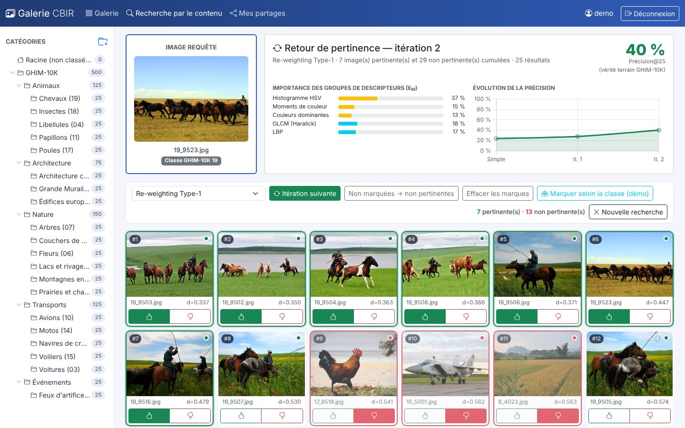
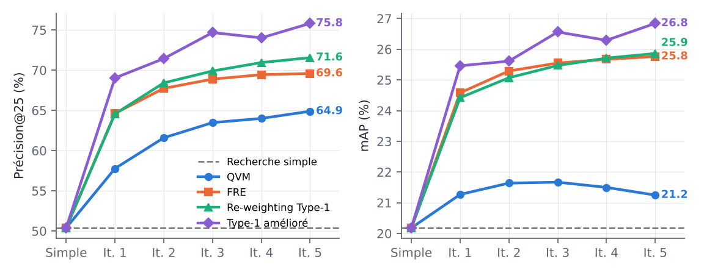
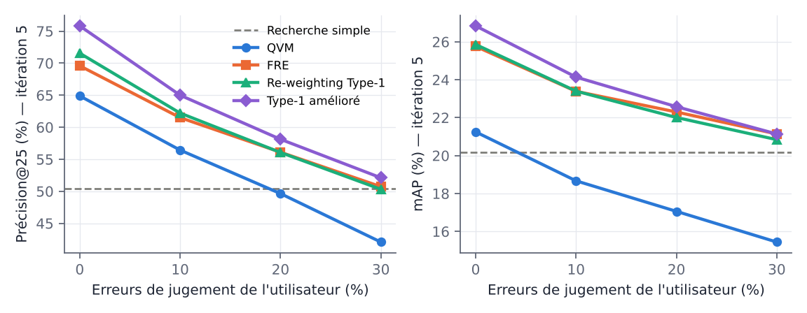
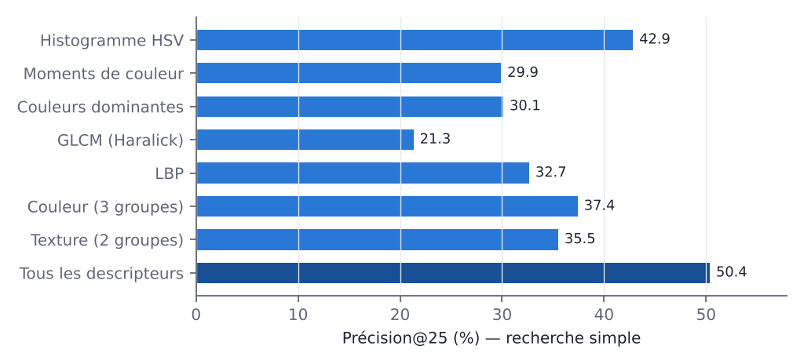
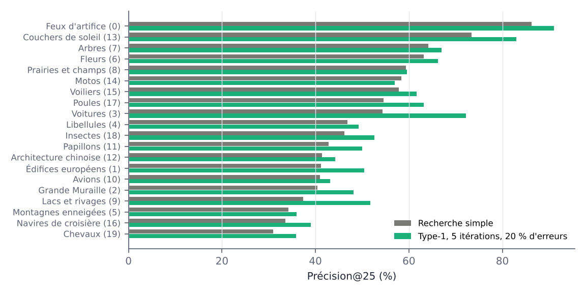
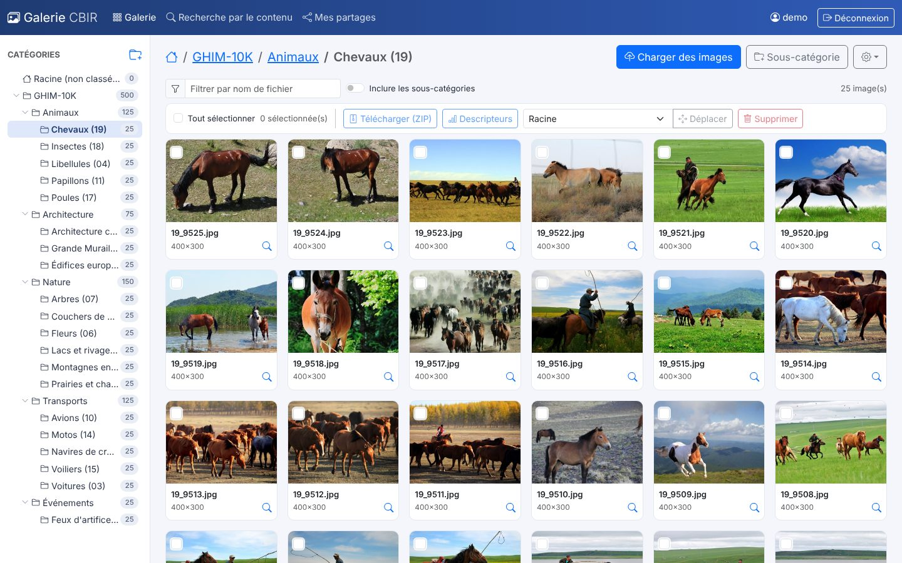
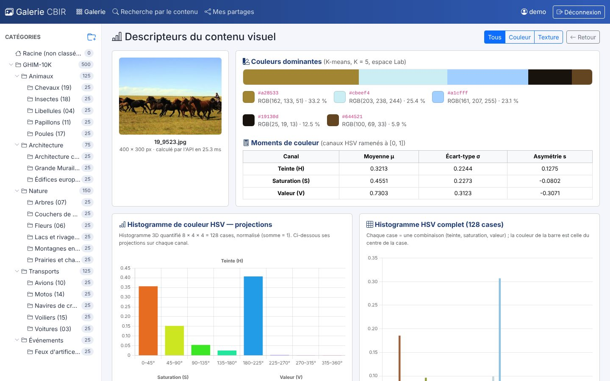
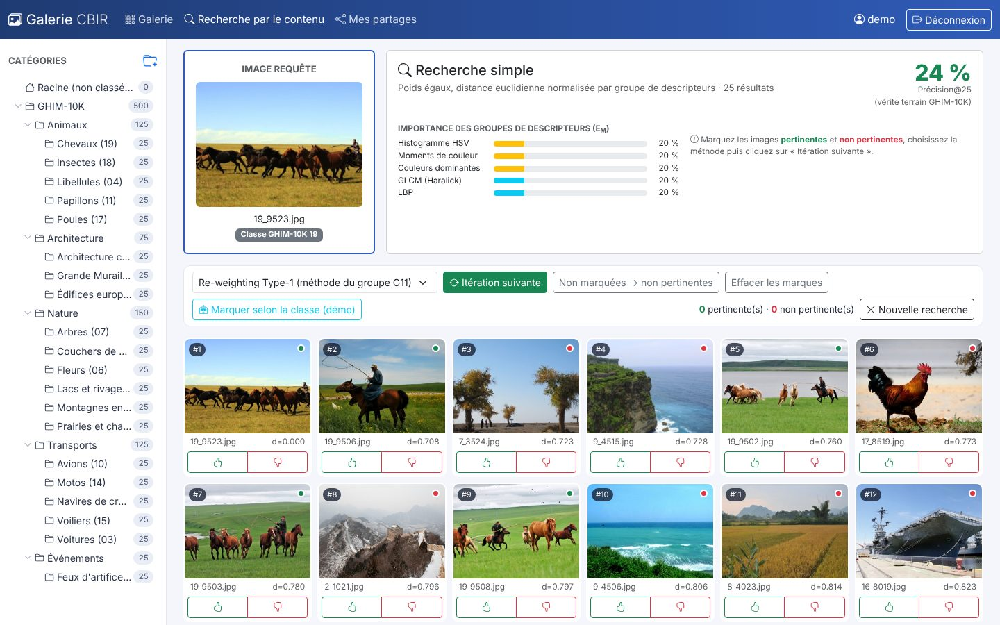
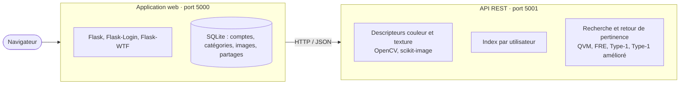

<div align="center">

# Galerie CBIR

**Gestion d'une galerie de photos et recherche d'images par le contenu, avec retour de pertinence**

[](https://github.com/Minyurano/galerie-cbir/actions/workflows/tests.yml)


<a href="https://minyurano.github.io/galerie-cbir/" title="Ouvrir l'application en ligne">
  
</a>

### 👉 [**CLIQUEZ ICI POUR ACCÉDER À L'APPLICATION EN LIGNE**](https://minyurano.github.io/galerie-cbir/)

[Résultats](#résultats-sur-ghim-10k) · [Captures d'écran](#captures-décran) · [Installation](#installation) · [API REST](#api-rest)



</div>

## Présentation

L'utilisateur range ses photos dans des catégories, puis cherche des images **par leur
contenu visuel** : il choisit une image requête et l'application renvoie les 25 images
les plus proches en couleur et en texture. Il indique ensuite lesquelles sont pertinentes ;
à chaque itération de **retour de pertinence**, le système ajuste la requête et le poids
de chaque descripteur pour mieux comprendre ce qu'il cherche.

Les descripteurs visuels sont calculés par une **API REST** indépendante (Flask-RESTful) ;
l'application web l'appelle par HTTP.

Projet du module *Recherche d'images par le contenu*, Master IASD (FST Tanger, Université
Abdelmalek Essaâdi, 2026/2027), groupe G11 : méthode **Re-weighting Type-1**.

## Fonctionnalités

| Gestion de la galerie | Recherche par le contenu |
|---|---|
| Comptes utilisateurs, catégories et sous-catégories | Recherche simple : distance euclidienne normalisée, poids égaux |
| Chargement d'images, d'un dossier entier ou d'une archive ZIP (dossiers → sous-catégories) | Retour de pertinence : **QVM**, **FRE**, **Re-weighting Type-1** |
| Déplacement, suppression, téléchargement (une image ou un ZIP) | |
| Nouvelles images par transformation (recadrage, rotation, filtres…) | Requête depuis la galerie ou depuis un fichier externe |
| Visualisation de tous les descripteurs d'une image (histogrammes HSV et R, G, B, image et histogramme LBP), export CSV | Poids des descripteurs et courbe de précision affichés à chaque itération |
| Partage en lecture seule par lien (expiration, révocation) | Utilisateur simulé (marquage selon la classe GHIM-10K) pour les démonstrations |

## Descripteurs visuels (181 valeurs)

| Famille | Descripteur | Taille |
|---|---|---|
| Couleur | Histogramme HSV quantifié 8 × 4 × 4 | 128 |
| Couleur | Moments de couleur (moyenne, écart-type, asymétrie sur H, S, V) | 9 |
| Couleur | 5 couleurs dominantes (K-means dans l'espace Lab) et leurs proportions | 20 |
| Texture | GLCM / Haralick : 7 propriétés à 2 distances | 14 |
| Texture | Motifs binaires locaux (LBP uniformes, P = 8, R = 1) | 10 |

Pour l'affichage seulement, l'API fournit aussi les histogrammes R, G, B et niveaux de gris,
l'histogramme LBP complet (256 motifs) et l'image LBP (`?details=1`).

## Retour de pertinence

D'après Renuka Devi SM, *Reweighing Strategies for Relevance Feedback in CBIR*, IJARCCE, 2016.

| Méthode | Groupes (énoncé) | Nouvelle requête | Poids de la composante *i* |
|---|---|---|---|
| QVM (Rocchio) | G3, G7, G9, G12, G15 | α·q + β·moy(pertinentes) − γ·moy(non pertinentes) | 1 |
| FRE (MARS) | G1, G5, G10, G13, G14, G16 | moyenne des images pertinentes | 1 / (ε + σ<sub>rel,i</sub>) |
| **Re-weighting Type-1** | G2, G4, G6, G8, **G11** | moyenne des images pertinentes | (ε + σ<sub>Nr,i</sub>) / (ε + σ<sub>rel,i</sub>), ε = 0,0001 (éq. 5) |

σ<sub>rel,i</sub> est l'écart-type de la composante sur les images pertinentes et σ<sub>Nr,i</sub>
sur les images retournées : une composante qui varie peu chez les images pertinentes mais
beaucoup dans les résultats est ce qui les distingue, elle reçoit donc un poids fort.

`type1` applique **exactement** l'équation 5 de l'article (méthode par défaut du groupe G11).
Le groupe propose aussi une extension, **Type-1 amélioré** (`type1plus`) : poids de l'équation 5
normalisés et plafonnés dans chaque descripteur, plus une importance par descripteur
(équation 14 de l'article, utilisée pour le Type-3). Elle est comparée à la version de l'article
ci-dessous.

## Résultats sur GHIM-10K

10 000 images en 20 classes, 400 requêtes (20 par classe), 25 images affichées par itération,
utilisateur simulé (une image est pertinente si elle est de la même classe que la requête).

| Méthode | P@25 initiale | P@25 après 5 itérations | mAP après 5 itérations |
|---|---|---|---|
| Recherche simple | 50,4 % | 50,4 % | 20,2 % |
| QVM | 50,4 % | 64,9 % | 21,2 % |
| FRE | 50,4 % | 69,6 % | 25,8 % |
| **Re-weighting Type-1** (article, groupe G11) | 50,4 % | **71,6 %** | **25,9 %** |
| Type-1 amélioré (extension G11) | 50,4 % | 75,8 % | 26,8 % |



Le Type-1 de l'article est nettement meilleur que QVM (test de Wilcoxon apparié sur l'AP,
p < 10<sup>-40</sup>) et équivalent à FRE en mAP (p = 0,30), avec une meilleure précision
sur les 25 images affichées. L'extension « Type-1 amélioré » gagne encore 4 points de
précision (p < 10<sup>-12</sup> face au Type-1 de l'article). Quand l'utilisateur se trompe
dans 10 à 30 % de ses jugements, QVM finit sous la recherche simple :



<details>
<summary>Apport de chaque descripteur et précision par classe</summary>




Résultats bruts : [`docs/figures/results.json`](docs/figures/results.json).
</details>

## Captures d'écran

| Galerie et catégories | Descripteurs d'une image |
|---|---|
|  |  |
| **Recherche simple** | **Après 2 itérations de retour de pertinence** |
|  |  |

## Architecture



| Dossier / fichier | Rôle |
|---|---|
| `config.py` | Configuration (chemins, ports, méthode par défaut) |
| `api/descriptors/` | Histogramme HSV, moments, couleurs dominantes, GLCM, LBP |
| `api/retrieval/` | Normalisation, distance pondérée, index, moteur de recherche, retour de pertinence |
| `api/app.py` | Points d'accès de l'API (Flask-RESTful) |
| `webapp/` | Application web : comptes, galerie, transformations, recherche, partage |
| `scripts/` | Import de GHIM-10K, extraction des descripteurs, évaluation, figures |
| `tests/` | Tests automatiques (pytest), lancés par GitHub Actions à chaque envoi |
| `index.html`, `demo/` | Démo en ligne (GitHub Pages) qui fonctionne entièrement dans le navigateur |

## Installation

```bash
git clone https://github.com/Minyurano/galerie-cbir.git
cd galerie-cbir
python -m venv .venv
.venv\Scripts\activate               # Linux / macOS : source .venv/bin/activate
pip install -r requirements.txt
```

Télécharger [GHIM-10K](https://www.kaggle.com/datasets/mcpython/ghim-10k) et placer le
dossier `GHIM-10K/` à la racine du projet (un sous-dossier par classe, ou la version plate
`classe_numéro.jpg`), ou indiquer son chemin avec la variable `GHIM_DIR`.

## Lancement

Dans deux terminaux :

```bash
python run_api.py      # API REST     -> http://127.0.0.1:5001/api/health
python run_web.py      # Application  -> http://127.0.0.1:5000
```

Importer GHIM-10K dans un compte de démonstration (API lancée ; `--limit 25` pour un essai rapide) :

```bash
python scripts/import_ghim.py --user demo --password demo1234
```

Se connecter ensuite avec `demo` / `demo1234`, ou créer un compte depuis la page d'inscription.

### Choisir la méthode de retour de pertinence

Les trois méthodes sont sélectionnables dans l'interface. La méthode par défaut est
Re-weighting Type-1 ; elle se change dans `config.py` (`DEFAULT_RF_METHOD`) ou par variable
d'environnement :

```bash
CBIR_RF_METHOD=qvm python run_api.py     # qvm, fre, type1 ou type1plus
```

## API REST

| Méthode | URL | Description |
|---|---|---|
| GET | `/api/health` | État du service |
| GET | `/api/rf-methods` | Méthodes de retour de pertinence |
| POST | `/api/descriptors` | Tous les descripteurs d'une ou plusieurs images (multipart `images` ; `?details=1` pour les histogrammes R, G, B et le LBP à 256 motifs) |
| POST | `/api/descriptors/color` | Descripteurs de couleur |
| POST | `/api/descriptors/texture` | Descripteurs de texture |
| GET | `/api/collections/<c>` | Taille d'une collection |
| POST | `/api/collections/<c>/images` | Indexer une image (multipart `image`, `image_id`) ou un lot (JSON `items`) |
| GET / DELETE | `/api/collections/<c>/images/<id>` | Lire / retirer une image de l'index |
| POST | `/api/collections/<c>/search` | Recherche simple (JSON `image_id` ou fichier `image`, `scope`) |
| POST | `/api/collections/<c>/feedback` | Itération de retour de pertinence (`session_id`, `method`, `relevant`, `non_relevant`) |

```bash
curl -F "images=@GHIM-10K/horses/19_9523.jpg" http://127.0.0.1:5001/api/descriptors/color
```

## Partager la galerie avec une personne éloignée

1. **Rendre la galerie accessible depuis Internet** (ordinateur et serveurs allumés) : dans
   VS Code, onglet **Ports** → **Forward a Port** → `5000` → clic droit → **Port Visibility →
   Public**, puis copier l'adresse transférée. Seul le port 5000 est ouvert : l'API reste locale.
2. **Créer un lien** : sur une catégorie (menu ⚙ → **Partager**) ou sur une image (**Partager
   cette image**), avec ou sans téléchargement et avec une durée de validité.
3. Dans **Mes partages**, enregistrer l'adresse publique puis **Copier** le lien.

Le destinataire voit les images en lecture seule, sans compte ; le lien peut être révoqué à
tout moment. L'adresse publique peut aussi être fixée par `CBIR_PUBLIC_URL`.

## Reproduire l'évaluation et lancer les tests

```bash
python scripts/extract_features.py      # descripteurs des 10 000 images (~2 min)
python scripts/evaluate.py              # P@25, mAP, bruit 0 à 30 %, tests de Wilcoxon
python scripts/make_figures.py          # figures dans docs/figures
python -m pytest -q                     # tests automatiques
```

## Données générées

`data/` (base SQLite, images chargées, miniatures, index, clé secrète, résultats) est créé
au premier lancement et n'est jamais envoyé sur GitHub. La clé qui signe les sessions est
tirée au hasard au premier lancement (`data/secret_key`), ou fixée par `CBIR_SECRET_KEY`.

## Licence

[MIT](LICENSE)
